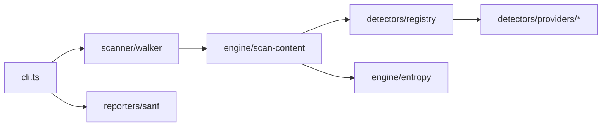

# hx-secrets-cli — architecture

## Purpose

Walks filesystem paths, scans file contents with a registry of regex/entropy-based
detectors for cloud and SaaS credentials, and reports matches with severity for humans
or SARIF consumers. Non-goals: git history mining, binary forensics, or live secret
validation against vendor APIs.

## High-level flow

## Module map

| Path                           | Responsibility                                           |
| ------------------------------ | -------------------------------------------------------- |
| `src/cli.ts`                   | `scan`, `grep`, `list-detectors` commands                |
| `src/scanner/walker.ts`        | Directory glob walk and per-file scan                    |
| `src/engine/scan-content.ts`   | Run all detectors on one buffer                          |
| `src/engine/entropy.ts`        | Entropy helper for generic high-entropy strings          |
| `src/detectors/registry.ts`    | `DETECTORS` array and registration                       |
| `src/detectors/types.ts`       | Detector interface and match shape                       |
| `src/detectors/providers/*.ts` | One module per provider pattern (AWS, GitHub, Stripe, …) |
| `src/reporters/sarif.ts`       | SARIF 2.1 serialization                                  |

## Extension

1. Add `src/detectors/providers/your-provider.ts` with `id`, `severity`, and `detect()`.
2. Import and append to `DETECTORS` in `detectors/registry.ts`.
3. Add unit tests with fixture strings — no real secrets in repo.
4. Run `npm test` and `npm run format:check`.

## Testing strategy

- **Unit**: individual detectors, `scan-content`, walker ignore rules, SARIF shape.
- **Integration**: none required; scans are local filesystem only.

## Ethics & scope

Authorized engagements only. See [SECURITY.md](./SECURITY.md).
